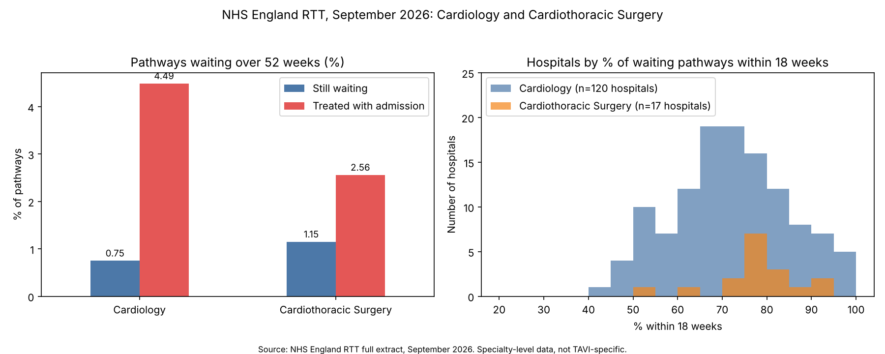
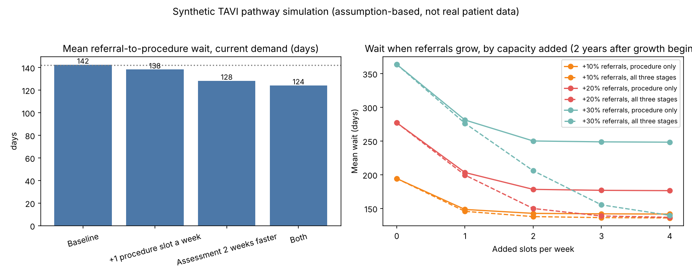

# Business-Clinical Question: How Can a TAVI Program Grow Its Share?

> **Note on data:** Public data only. No real patient, hospital or company data is used. Any patient-level pathway data is **synthetic** and labelled as such.

| | |
|---|---|
| Live dashboard | [GCC TAVI Market Opportunity Model](https://tavi-gcc-market-opportunity-mode-iy7nxbmcjkkcg6eudp7aud.streamlit.app/) |
| Companion repo | [TAVI-GCC-market-opportunity-mode](https://github.com/yosras-dotcomAi/TAVI-GCC-market-opportunity-mode) |

## The answer first

TAVI share does not grow only by winning against competitors. It grows in two ways, and most of the room is in the first:

1. **Grow the pie:** more patients with severe aortic stenosis are detected, referred, and treated.
2. **Grow the slice:** within the patients who are treated, more procedures use your valve.

```
TAVI share = eligible patients  x  treatment rate  x  your share of treated patients
                                         ^                        ^
                                   grow the pie             grow the slice
```

England is a useful benchmark for the first lever. It performed about 136 TAVI procedures per million people in 2022/23, still below Western Europe and the US (141 and 176 per million in 2019) ([PMC11413983](https://pmc.ncbi.nlm.nih.gov/articles/PMC11413983/)). A UK survey of TAVI centres found cath lab capacity and bed numbers were the most common limits on expansion (74% and 56% of centres) ([PMC7996656](https://pmc.ncbi.nlm.nih.gov/articles/PMC7996656)). A health system that cannot treat patients fast enough has a ceiling no sales effort can lift.

## Where growth is blocked: the patient pathway

```mermaid
flowchart LR
    A[Severe aortic stenosis detected] -->|"Lever 1: detection"| B[Referred to heart team]
    B -->|"Lever 2: referral speed"| C[CT and assessment]
    C -->|"Lever 3: lab and bed capacity"| D[Procedure slot]
    D -->|"Levers 5 to 7: centre readiness, valve availability, procurement"| E[TAVI performed]
    E -->|"Lever 8: outcomes evidence"| F[Follow-up and registry data]
```



## Growth levers

Each lever is a **hypothesis to test**, not a conclusion. Results get added to this table as the analysis is built.

### Grow the pie

| # | Lever | Question | Metric | Public data |
|---|---|---|---|---|
| 1 | Detection | How many patients with severe aortic stenosis are never diagnosed? | Diagnosed vs estimated prevalence | Prevalence inputs in the Opportunity Model |
| 2 | Referral speed | How long from referral to procedure, and where is the delay? | Days, referral to procedure (a UK estimate of about 142 days is reported in [Cardiovascular News](https://cardiovascularnews.com/tackling-unacceptable-mortality-in-aortic-stenosis-a-call-to-expand-tavi-access/), an advocacy article, so treat it as an estimate) | NHS England RTT, NICOR reports |
| 3 | Lab and bed capacity | How many extra procedures does one more weekly slot create? | Procedures per centre per week, slot utilisation | Synthetic pathway simulation |
| 4 | New centres | How many centres are needed per million people to reach the benchmark? | Centres and procedures per million | NICOR reports, Opportunity Model |

### Grow the slice

| # | Lever | Question | Metric | Public data |
|---|---|---|---|---|
| 5 | Centre readiness | How quickly does a new centre reach independent, steady volume? | Time to first case, cases per operator | NICOR centre volume reports |
| 6 | Valve availability | Are cases delayed or changed because a valve size is not in stock? | Cases delayed by stock, size mix | Synthetic supply simulation |
| 7 | Procurement | How do central tenders and purchasing rules shape which valve a hospital can use? | Tender cycle, listed products | Public tender and catalogue notices |
| 8 | Outcomes evidence | Which outcomes do clinicians and buyers look at before choosing a valve? | Mortality, stroke, pacemaker rates | NICOR registry reports |

## How the levers will be ranked

Each lever is scored on **impact** (extra procedures per year in the model) and **feasibility** (time and cost to act), then plotted on a simple 2x2 grid in the dashboard. The output is a short list of two or three levers to act on first, not a long list of ideas.

## First results: NHS England RTT, September 2026



| Specialty | Pathway type | Pathways | Within 18 weeks | Over 52 weeks |
|---|---|---|---|---|
| Cardiology | Still waiting | 355,950 | 68.9% | 2,660 (0.75%) |
| Cardiology | Treated with admission | 10,102 | 64.7% | 454 (4.49%) |
| Cardiothoracic Surgery | Still waiting | 8,262 | 73.9% | 95 (1.15%) |
| Cardiothoracic Surgery | Treated with admission | 1,369 | 70.1% | 35 (2.56%) |

What this shows, and what it does not:

- **Patients treated with an admission waited longer than the general waiting list.** In Cardiology, 4.49% of admitted pathways waited over 52 weeks, against 0.75% of pathways still waiting. Procedures such as TAVI are delivered through admission, so this points to the procedure stage as a bottleneck (levers 2 and 3).
- **Hospitals differ widely.** Among 120 Cardiology services with 100 or more waiting pathways, the share treated within 18 weeks ranges from about 44% to 97% (median about 72%). Among 17 Cardiothoracic services it ranges from about 52% to 93% (median about 78%).
- **This is specialty-level data.** It does not identify TAVI patients, and the file does not say which hospitals perform TAVI. The results are a context baseline, not a TAVI waiting time.

Data and code: `data/` holds the cleaned files, built from the NHS England RTT full extract for September 2026. `analyze_rtt.py` rebuilds the chart from them.

```
pip install -r requirements.txt
python analyze_rtt.py
```

## Pathway simulation (synthetic)



A weekly simulation of a regional TAVI program: referral, assessment (echo, CT, clinic), heart team, pre-procedure work, then a procedure slot. Each stage has a weekly capacity and patients are served first come, first served. **All patient-level data is synthetic.** The baseline is calibrated so the mean referral-to-procedure time is about 142 days, the UK estimate quoted above (an advocacy source, so treat it as an estimate). 40 repeated runs are averaged for every scenario.

| Assumption | Value |
|---|---|
| Referrals | 12 a week (about 620 a year) |
| Capacity | Assessment 14 a week, heart team 14 a week, procedure slots 12.5 a week |
| Mean stage delays | 10.6 weeks to heart team readiness, 8.7 weeks to procedure readiness (set to match the 142-day total) |
| Not modelled | Urgent fast-tracking, deaths or drop-outs while waiting, weekends and holidays |

**Current demand:**

| Scenario | Mean wait (days) | 90th percentile | Waiting over 18 weeks |
|---|---|---|---|
| Baseline | 142 | 204 | 59% |
| +1 procedure slot a week | 138 | 200 | 55% |
| Assessment 2 weeks faster | 128 | 183 | 47% |
| Both | 124 | 179 | 43% |

**If referrals grow** (mean wait in days, two years after growth begins):

| Referral growth | No added capacity | +2 procedure slots only | +2 slots at all three stages | +3 slots at all three stages |
|---|---|---|---|---|
| +10% | 194 | 143 | 138 | 136 |
| +20% | 277 | 178 | 150 | 139 |
| +30% | 364 | 250 | 206 | 155 |

What this suggests, and its limits:

- **At today's demand, one extra slot changes little** (142 to 138 days). The fixed delays inside the pathway matter more. The assessment result is arithmetic: a 2-week cut in the assumed delay lowers the total by about the same amount.
- **Growth in referrals is where capacity matters.** Without added slots, 10% more referrals raise the average wait from 142 to 194 days, and 30% more push it to 364.
- **The bottleneck moves.** Adding procedure slots alone stops helping once assessment and heart team capacity become the limit. At +30% referrals, procedure slots alone plateau near 248 days, while expanding all three stages brings the wait back toward 140.
- **For market share:** growing the number of patients treated depends on capacity across the whole pathway, not on one stage. This supports levers 2 to 5 above.
- **These are assumption-based results, not forecasts.** The 142-day total is the only calibration point. Capacity and stage delay values are assumptions and are set at the top of `simulate_pathway.py`. Change them and re-run.

```
python simulate_pathway.py
```

Outputs: `data/synthetic_tavi_pathway_baseline.csv` (one year of synthetic referrals), `results/scenario_levers.csv`, `results/scenario_stress_test.csv`, `charts/chart_pathway_scenarios.png`.

## Sub-questions behind the analysis

1. **Volume and growth:** how have TAVI volumes changed compared with surgical aortic valve replacement (SAVR)?
2. **Capacity and waiting:** where is the gap between patients with severe aortic stenosis and lab and bed throughput?
3. **Age and length of stay:** as TAVI reaches lower-risk and younger patients, how do length of stay and resource use change?
4. **Benchmarking:** can UK performance be a baseline for GCC readiness, and what does not transfer?

## Data sources

| Source | Used for | Limit |
|---|---|---|
| NHS England Referral to Treatment (RTT) waiting times | Monthly waits by specialty and provider (Cardiology, Cardiothoracic Surgery) | Specialty level, **not TAVI-specific** |
| NICOR UK TAVI Registry (published reports) | TAVI volumes, outcomes, centre activity | Published aggregates only |
| NHS England Hospital Episode Statistics (HES) | Procedure counts, length of stay | See coding note |

**Coding note.** TAVI is not one OPCS-4 code. NICE coding guidance records TAVI as an aortic valve code in `K26.-` together with an approach code: `Y79.-` (transluminal) or `Y49.4` (transapical). Surgical valve replacement also sits in `K26.-`, so counting `K26` alone mixes the two ([Bortolussi et al., BMJ Open 2019](https://discovery-pp.ucl.ac.uk/id/eprint/10072218/1/e023316.full.pdf)). The diagnosis code is ICD-10 `I35.0`. Public HES tables are aggregated, so TAVI volumes here come from NICOR reports.

## Status

- [x] Business and clinical questions defined
- [x] Companion dashboard live
- [x] RTT Cardiology and Cardiothoracic baseline added to `data/`
- [x] Baseline analysis script and chart added
- [x] Pathway simulation (synthetic) added
- [ ] Lever ranking added to the dashboard
- [ ] Recommendations added to this README

## Limitations

- RTT data does not isolate TAVI patients.
- The NHS is a single-payer system with a different age structure and funding model from GCC markets, so benchmarks show direction, not forecasts.
- Patient-level pathway data is synthetic. Market share inputs are assumptions until real figures are available from public sources.

## Author
**Yosra El Nagar**, Cath Lab Head Nurse moving into Healthcare Data Analytics. [LinkedIn](https://www.linkedin.com/in/yosra-nagar-9a6862118/)
GitHub: [@yosras-dotcomAi](https://github.com/yosras-dotcomAi)
