# Business-Clinical Question: How Can a TAVI Program Grow Its Share?

> **Note on data:** Public data only. No real patient, hospital or company data is used. Any patient-level pathway data is **synthetic** and labelled as such.

| | |
|---|---|
| Live dashboard | [GCC TAVI Market Opportunity Model](https://tavi-gcc-market-opportunity-mode-iy7nxbmcjkkcg6eudp7aud.streamlit.app/) |
| Companion repo | [TAVI-GCC-market-opportunity-mode](https://github.com/yosras-dotcomAi/TAVI-GCC-market-opportunity-mode) |

## The answer first

TAVI share does not grow only by winning against competitors. It grows in two ways, and most of the room is in the first:

1. **Grow the pie:** more patients with severe aortic stenosis are detected, referred, and treated.
2. **Grow the slice:** within the patients who are treated, more procedures use your valve.

```
TAVI share = eligible patients  x  treatment rate  x  your share of treated patients
                                         ^                        ^
                                   grow the pie             grow the slice
```

England is a useful benchmark for the first lever. It performed about 136 TAVI procedures per million people in 2022/23, still below Western Europe and the US (141 and 176 per million in 2019) ([PMC11413983](https://pmc.ncbi.nlm.nih.gov/articles/PMC11413983/)). A UK survey of TAVI centres found cath lab capacity and bed numbers were the most common limits on expansion (74% and 56% of centres) ([PMC7996656](https://pmc.ncbi.nlm.nih.gov/articles/PMC7996656)). A health system that cannot treat patients fast enough has a ceiling no sales effort can lift.

## Where growth is blocked: the patient pathway

```mermaid
flowchart LR
    A[Severe aortic stenosis detected] -->|"Lever 1: detection"| B[Referred to heart team]
    B -->|"Lever 2: referral speed"| C[CT and assessment]
    C -->|"Lever 3: lab and bed capacity"| D[Procedure slot]
    D -->|"Levers 5 to 7: centre readiness, valve availability, procurement"| E[TAVI performed]
    E -->|"Lever 8: outcomes evidence"| F[Follow-up and registry data]
```



## Growth levers

Each lever is a **hypothesis to test**, not a conclusion. Results get added to this table as the analysis is built.

### Grow the pie

| # | Lever | Question | Metric | Public data |
|---|---|---|---|---|
| 1 | Detection | How many patients with severe aortic stenosis are never diagnosed? | Diagnosed vs estimated prevalence | Prevalence inputs in the Opportunity Model |
| 2 | Referral speed | How long from referral to procedure, and where is the delay? | Days, referral to procedure (a UK estimate of about 142 days is reported in [Cardiovascular News](https://cardiovascularnews.com/tackling-unacceptable-mortality-in-aortic-stenosis-a-call-to-expand-tavi-access/), an advocacy article, so treat it as an estimate) | NHS England RTT, NICOR reports |
| 3 | Lab and bed capacity | How many extra procedures does one more weekly slot create? | Procedures per centre per week, slot utilisation | Synthetic pathway simulation |
| 4 | New centres | How many centres are needed per million people to reach the benchmark? | Centres and procedures per million | NICOR reports, Opportunity Model |

### Grow the slice

| # | Lever | Question | Metric | Public data |
|---|---|---|---|---|
| 5 | Centre readiness | How quickly does a new centre reach independent, steady volume? | Time to first case, cases per operator | NICOR centre volume reports |
| 6 | Valve availability | Are cases delayed or changed because a valve size is not in stock? | Cases delayed by stock, size mix | Synthetic supply simulation |
| 7 | Procurement | How do central tenders and purchasing rules shape which valve a hospital can use? | Tender cycle, listed products | Public tender and catalogue notices |
| 8 | Outcomes evidence | Which outcomes do clinicians and buyers look at before choosing a valve? | Mortality, stroke, pacemaker rates | NICOR registry reports |

## How the levers will be ranked

Each lever is scored on **impact** (extra procedures per year in the model) and **feasibility** (time and cost to act), then plotted on a simple 2x2 grid in the dashboard. The output is a short list of two or three levers to act on first, not a long list of ideas.

## Sub-questions behind the analysis

1. **Volume and growth:** how have TAVI volumes changed compared with surgical aortic valve replacement (SAVR)?
2. **Capacity and waiting:** where is the gap between patients with severe aortic stenosis and lab and bed throughput?
3. **Age and length of stay:** as TAVI reaches lower-risk and younger patients, how do length of stay and resource use change?
4. **Benchmarking:** can UK performance be a baseline for GCC readiness, and what does not transfer?

## Data sources

| Source | Used for | Limit |
|---|---|---|
| NHS England Referral to Treatment (RTT) waiting times | Monthly waits by specialty and provider (Cardiology, Cardiothoracic Surgery) | Specialty level, **not TAVI-specific** |
| NICOR UK TAVI Registry (published reports) | TAVI volumes, outcomes, centre activity | Published aggregates only |
| NHS England Hospital Episode Statistics (HES) | Procedure counts, length of stay | See coding note |

**Coding note.** TAVI is not one OPCS-4 code. NICE coding guidance records TAVI as an aortic valve code in `K26.-` together with an approach code: `Y79.-` (transluminal) or `Y49.4` (transapical). Surgical valve replacement also sits in `K26.-`, so counting `K26` alone mixes the two ([Bortolussi et al., BMJ Open 2019](https://discovery-pp.ucl.ac.uk/id/eprint/10072218/1/e023316.full.pdf)). The diagnosis code is ICD-10 `I35.0`. Public HES tables are aggregated, so TAVI volumes here come from NICOR reports.

## Status

- [x] Business and clinical questions defined
- [x] Companion dashboard live
- [ ] RTT Cardiology and Cardiothoracic baseline added to `data/`
- [ ] Pathway simulation (synthetic) added
- [ ] Lever ranking added to the dashboard
- [ ] Results and recommendations added to this README

## Limitations

- RTT data does not isolate TAVI patients.
- The NHS is a single-payer system with a different age structure and funding model from GCC markets, so benchmarks show direction, not forecasts.
- Patient-level pathway data is synthetic. Market share inputs are assumptions until real figures are available from public sources.

## Author

**Yosra El-Naggar**, Nursing Supervisor (Critical Care and Cardiac Catheterization) and Healthcare Data Analyst.
GitHub: [@yosras-dotcomAi](https://github.com/yosras-dotcomAi)
